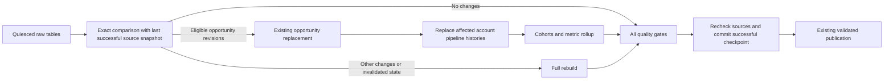

# Controlled local selective rebuilds

An opportunity correction need not reaggregate every account-day or rebuild unrelated invoice, cash and subscription facts. This opt-in DuckDB lane retains the existing affected-opportunity fact replacement and narrows its downstream pipeline rebuild to complete affected **account histories**. Owner/region attribution is still evaluated at each business date; obsolete rows are deleted before replacement.

[Executed report](evidence/performance/report.md) · [Predeclared protocol](evidence/performance/protocol.json) · [Original exact-head verification](evidence/performance/exact-main-verification.json).



## Supported contract

- Explicit opt-in through `revenue_platform.selective.rebuild`; normal dbt execution and the Snowflake path retain their default full-table pipeline behavior.
- Eligible revisions are appended with a strictly newer ingest batch and stable event/opportunity/account identities. Exact source comparisons, not count/hash signatures, detect changes. The controller selects opportunity descendants plus **every dbt test**.
- A no-op still executes all quality gates. Historical owner/region changes, financial events, subscription changes, nonmonotonic revisions, calendar/coverage changes, policy/code changes and incomplete state trigger a full rebuild. This is deliberately conservative.
- All raw tables have a successful and a pending snapshot. The successful state advances only after transformation, all quality gates and a second source comparison. Extra storage and scan costs are measured, not hidden.
- Inputs must be quiesced. The advisory build lock serializes controller calls only. It is not a source writer lock, warehouse service, concurrency protocol or physical-delete guarantee. Do not rename a built DuckDB catalog and expect its catalog-qualified views to remain valid; catalog identity invalidates selective state and forces a full rebuild.
- Failures never update the published pointer. A killed process may leave a stale lock: verify it is no longer running before explicitly removing that exact lock and retrying in the same private workspace. No automatic stale-lock takeover is performed.

## Reproduce

From a clean checkout with Python 3.12:

```text
python -m pip install -r requirements-performance.lock
python -m pip install --no-deps --no-build-isolation -e .
python -m pytest -q
python scripts/benchmark_performance.py --profile enterprise --workspace .local/perf-enterprise-new --output .local/proof-enterprise-new
python scripts/benchmark_performance.py --profile stress --workspace .local/perf-stress-new --output .local/proof-stress-new
python scripts/check_performance.py
```

Each benchmark uses three fresh paired workspaces by default. Baseline transformations execute the exact archived main source at `a39d603`; optimized runs execute the recorded feature revision. A third warehouse loads the same corrected CSVs independently for clean full-refresh comparison. Every row of all 15 models is compared: every model uses grain-ordered typed Parquet exports on independently bound connections, followed by a complete byte comparison. Native typed values preserve nulls, Unicode and floating/decimal values. HUGEINT is exported as exact integer text to avoid a lossy Parquet cast. Unique model grains are checked before ordering; all fields are compared, through exact bytes or complete Arrow batches when file encodings differ. Large daily models are compared across every distinct business date, including a null-date partition if present; matching date inventories and exported-row totals enforce full coverage. Schemas must agree and unsupported complex types are refused. This compares all content, not probabilistic signatures; temporary exports remain private and are removed after comparison.

The harness measures generation, loading, transformations, no-op replay, resource samples and correctness checks separately. It stops a child stage after 20 minutes, above 6GiB sampled process-tree RSS or below 1GiB available host memory. Preflight requires 4GiB available memory and 50GiB free disk. These are conservative local guards, not DuckDB capacity guarantees. Failed runs and logs remain private under `.local`; sanitized outcomes belong in a new evidence directory, never over historical records.

Existing `scripts/verify.py` also regenerates current example evidence. Run it in a disposable checkout or preserve those outputs separately and restore the historical records before publication. This extension does not relabel regenerated observations as original Snowflake execution.

## Technical references

- [DuckDB EXPLAIN and profiling](https://duckdb.org/docs/lts/sql/statements/profiling)
- [DuckDB memory-limit boundaries](https://duckdb.org/docs/stable/guides/performance/oom_errors)
- [dbt descendant selection](https://docs.getdbt.com/reference/node-selection/graph-operators)

These are local synthetic performance and reliability observations, not managed Snowflake benchmarks, production capacity or commercial savings.

## Executed resource boundary

The 180,000-account stress profile completed three pairs and complete comparison of the 37,375,442-row daily fact. The [aggregate supervisor record](evidence/performance/stress/supervisor.json) observed 3,685,621,760 bytes of sampled process-tree RSS and a minimum 1,147,424,768 bytes of available host memory, narrowly above the 1GiB stop threshold. This shared-host run is not a capacity guarantee. Loading retained the original engine defaults; paired transformations and comparisons used one thread and the configured 2GB engine limit.

For aggregate guarding of the parent comparison process as well as workers, use `python scripts/supervise_performance.py` with the same benchmark arguments. The wrapper does not change source data, transformations or correctness checks.
